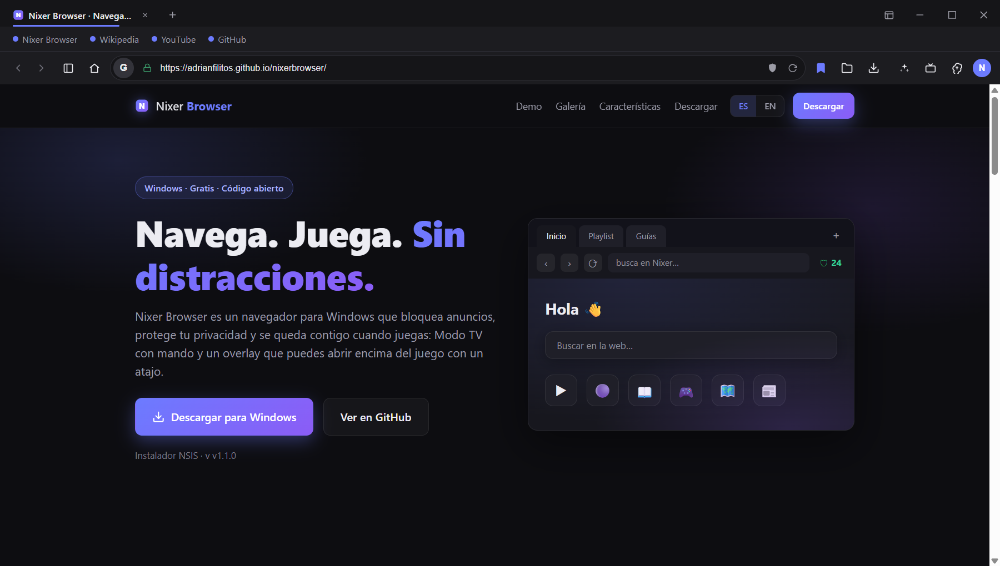
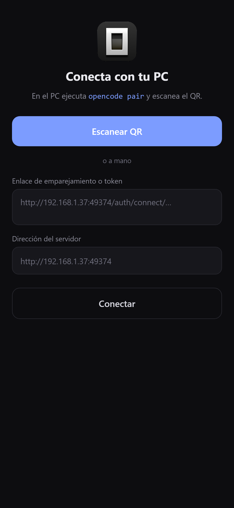
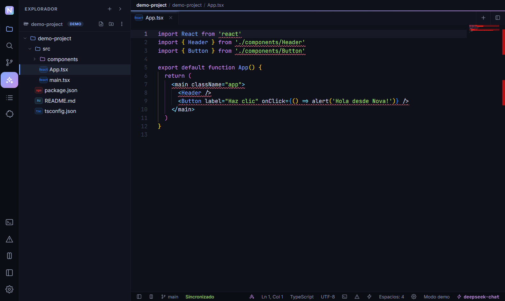

# Nixer

*I take software apart to learn how it's built, then build my own version.*

[adrianfilitos.github.io](https://adrianfilitos.github.io/) · [GitHub](https://github.com/adrianfilitos) · [Email](mailto:adrianfilitos@gmail.com)

Mostly self-taught, mostly on Windows. My projects tend to start with *can this
run here?* and end with the answer being yes.

---

## Selected work

### [Nixer Browser](https://github.com/adrianfilitos/nixerbrowser)

A Chromium browser with its own React interface: native shields and ad blocking,
cloud-synced profiles, page-aware AI and full extension support.

---

### [opencode-mobile](https://github.com/adrianfilitos/opencode-mobile)

iOS client for my self-hosted OpenCode server, plus a small Windows helper that
makes the local server reachable from the phone.

---

### [Nova](https://github.com/adrianfilitos/deneb-editor)

A code editor with AI built in, for web and desktop. Monaco under the hood, a
real LSP, a working debugger and a VS Code extension host.

---

## Stack

---

## Say hi

